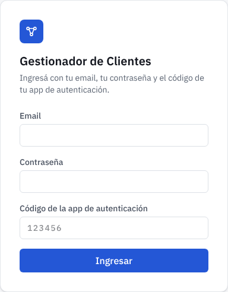
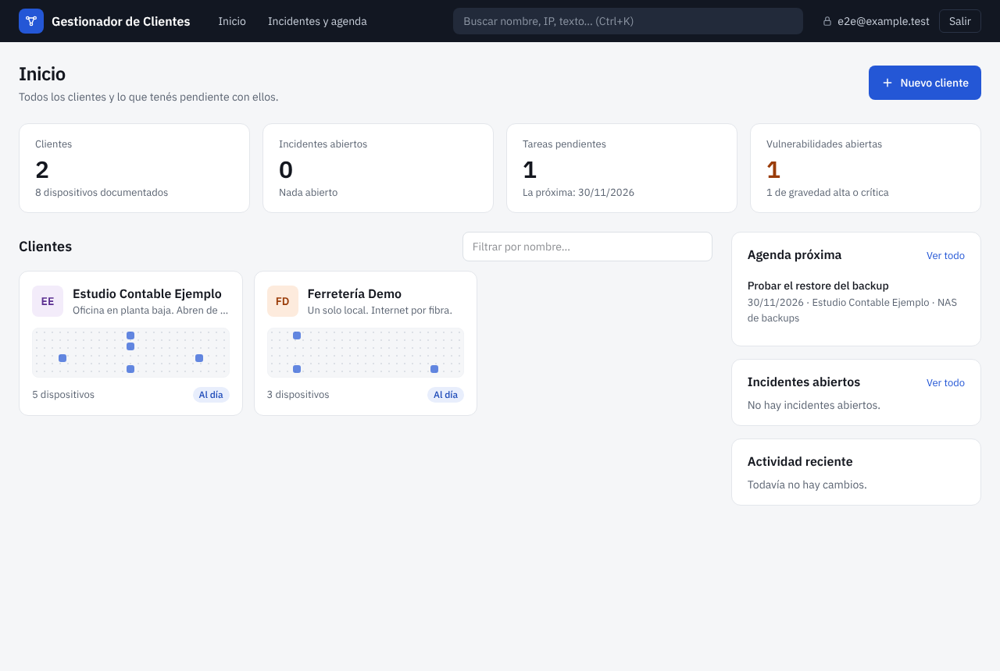
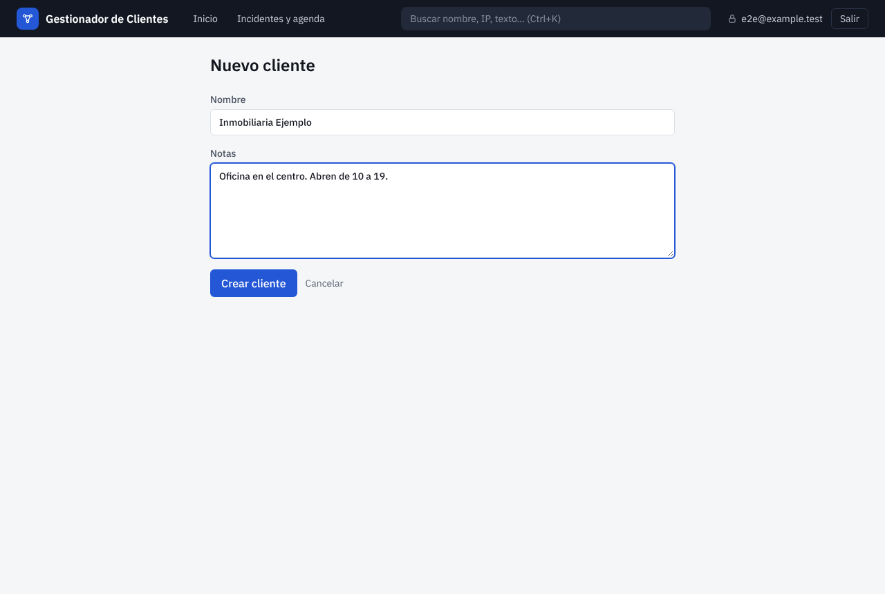
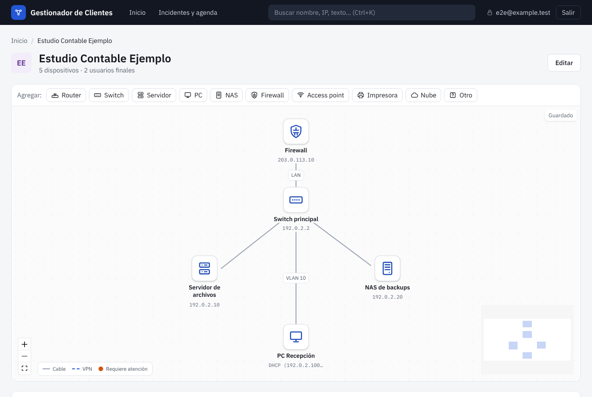
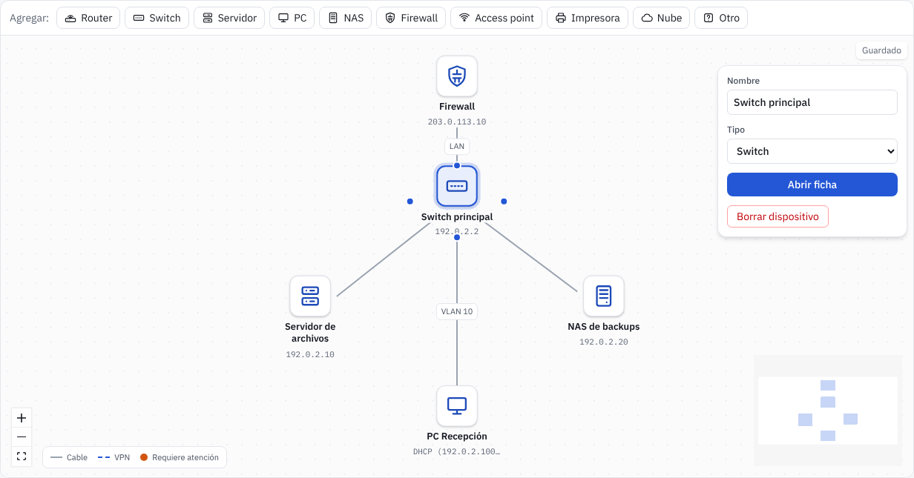
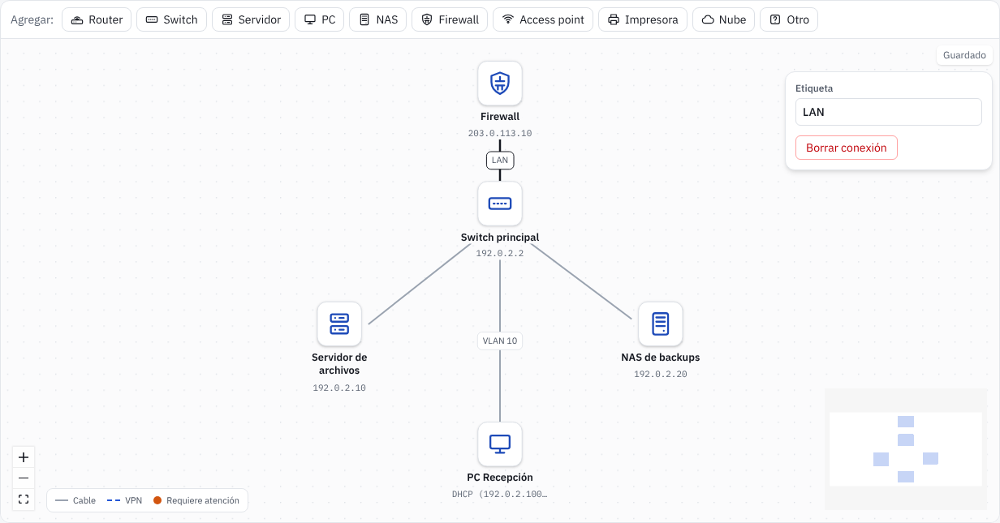
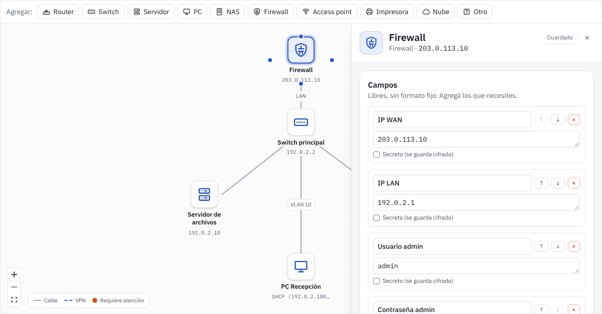
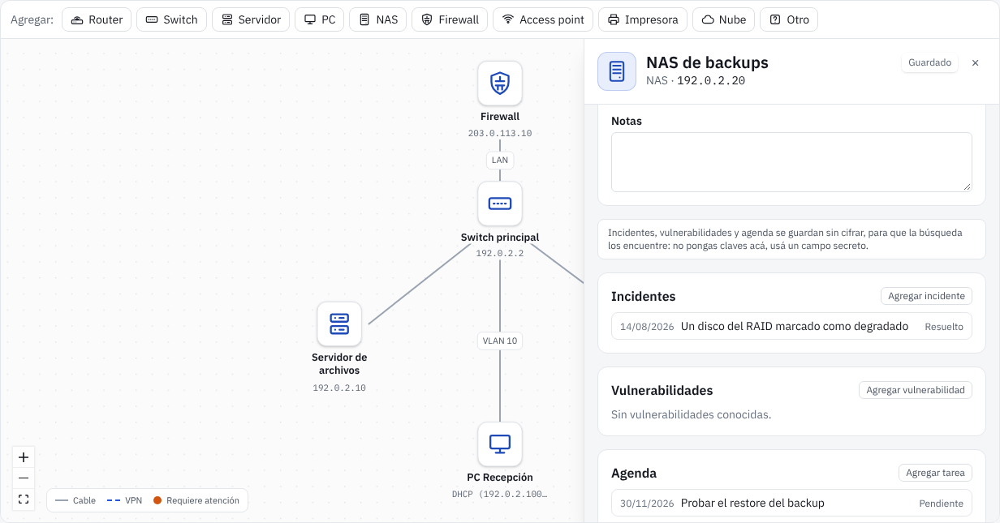
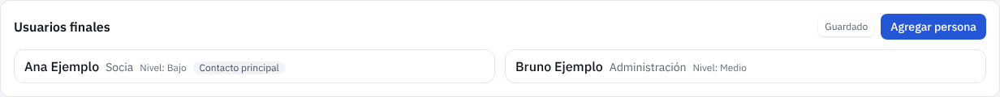
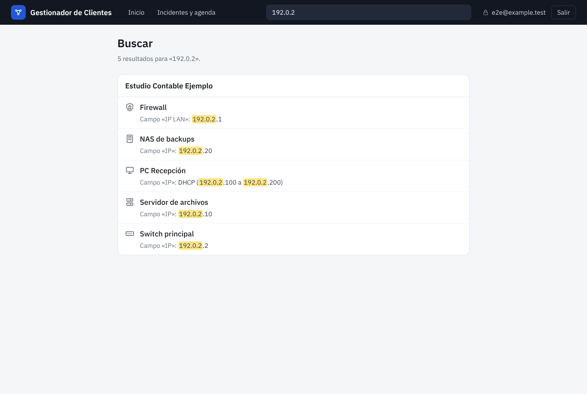

# Guía de uso

Esta guía es para quien usa Gestionador de Clientes en el día a día. Cada sección es una tarea
corta y no hace falta leerlas en orden. Las capturas muestran los datos de ejemplo: todo lo que
aparece en ellas (clientes, IPs, contraseñas) es inventado.

Para instalar la app en un servidor está [deployment.md](deployment.md), y
[user-checklist.md](user-checklist.md) es la hoja de una página con lo que el usuario tiene que
cuidar.

- [1. Entrar](#1-entrar)
- [2. Cargar un cliente](#2-cargar-un-cliente)
- [3. Dibujar la red](#3-dibujar-la-red)
- [4. Anotar los datos de un dispositivo](#4-anotar-los-datos-de-un-dispositivo)
- [5. Guardar una contraseña](#5-guardar-una-contraseña)
- [6. Pegar una captura de una configuración](#6-pegar-una-captura-de-una-configuración)
- [7. Registrar incidentes, vulnerabilidades y tareas](#7-registrar-incidentes-vulnerabilidades-y-tareas)
- [8. Anotar a las personas del cliente](#8-anotar-a-las-personas-del-cliente)
- [9. Buscar cualquier cosa](#9-buscar-cualquier-cosa)
- [10. Si algo sale mal](#10-si-algo-sale-mal)

Una regla para toda la app: **no hay botón de guardar**. Cada cambio se guarda solo cuando salís
del campo, y arriba a la derecha aparece **Guardado**.

## 1. Entrar

Para entrar hacen falta tres cosas: el email, la contraseña y el código de 6 dígitos de la app
de autenticación del celular (Google Authenticator, Aegis, 1Password…). El código cambia cada 30
segundos y cada código sirve una sola vez.

No hay página para registrarse: la cuenta la crea quien administra el servidor, que en ese momento
te muestra un código QR para escanear con el celular.

La sesión se cierra sola después de una hora sin usar la app, y a las 8 horas en cualquier caso.
Si fallás varias veces seguidas, la app te frena unos minutos: esperá y volvé a probar.

## 2. Cargar un cliente

La pantalla de inicio muestra los totales, una tarjeta por cliente (con un dibujito de su mapa) y,
al costado, las próximas tareas, los incidentes abiertos y los últimos cambios. El cuadro
**Filtrar por nombre…** filtra las tarjetas. **Incidentes y agenda**, arriba, junta las tareas de
la semana y los incidentes de todos los clientes; cada renglón abre la ficha del dispositivo.

1. Tocá **Nuevo cliente**.
2. Poné el nombre y, si querés, notas: dirección, horarios, cómo se trabaja con ellos.
3. Tocá **Crear cliente**. Se abre la página del cliente, con su mapa vacío.

Para cambiar el nombre o las notas, abrí el cliente y tocá **Editar**. Desde ahí también se
puede borrar: la app pide escribir el nombre del cliente para confirmar, porque se borra todo lo
que tiene (dispositivos, campos, capturas).

## 3. Dibujar la red

El mapa es la página principal de cada cliente.

- **Agregar un dispositivo:** hacé click en un tipo de la barra de arriba del mapa (Router,
  Switch, Servidor, PC, NAS…) o arrastralo al lugar del mapa donde lo quieras.
- **Moverlo:** arrastralo. La posición se guarda sola.
- **Renombrarlo o cambiarle el tipo:** hacé un click en el dispositivo y usá el panel que aparece
  a la derecha.

- **Conectar dos dispositivos:** al seleccionar uno aparecen puntos en sus bordes. Arrastrá
  desde un punto hasta el otro dispositivo.
- **Ponerle nombre a una conexión** (WAN1, VPN IPsec, VLAN 20…): hacé click en la línea y escribí
  la etiqueta. Las que dicen VPN, IPsec o túnel se dibujan punteadas y en azul.

- **Borrar** un dispositivo o una conexión: seleccionalo y tocá **Borrar dispositivo** o
  **Borrar conexión**, o apretá Supr.
- **Moverte por el mapa:** arrastrá el fondo para desplazarte y usá la rueda del mouse o los
  botones + y − para el zoom. El botón de abajo de todo encuadra el mapa entero.

Debajo de cada dispositivo se ve su IP, sacada del primer campo que se llame "IP" (o "IP LAN",
"Dirección IP"…) y no sea secreto. Un dispositivo con un incidente abierto o una tarea vencida
aparece marcado en naranja, para que se vea de un vistazo qué necesita atención.

## 4. Anotar los datos de un dispositivo

**Doble click** en un dispositivo abre su ficha a la derecha. Se cierra con la ✕ o con Escape.

En **Campos** no hay nada obligatorio ni fijo: cada campo tiene un nombre y un valor, y se pueden
agregar todos los que hagan falta.

- **Agregar campo** crea uno vacío. Los botones con **+** (por ejemplo "+ IP" o "+ Máscara") son
  sugerencias según el tipo de dispositivo: un click y el campo aparece con el nombre puesto.
- El valor puede tener varias líneas, para pegar una configuración o una lista.
- Las flechas ↑ ↓ cambian el orden y la ✕ roja borra el campo.

Más abajo en la ficha están **Funciones (quién hace qué)**, por ejemplo "DHCP y DNS de la
oficina, lo administra el proveedor", y **Notas** para todo lo demás.

## 5. Guardar una contraseña

Cualquier campo puede ser secreto: marcá **Secreto (se guarda cifrado)** debajo del valor. Desde
ese momento:

- El valor se guarda cifrado y se muestra como `••••••••`.
- **Ver** lo muestra y a los 30 segundos se vuelve a esconder solo (o antes, con **Ocultar**).
  **Copiar** lo copia sin mostrarlo y **Cambiar** lo reemplaza.
- Cada vez que alguien ve o copia un secreto queda registrado.
- La búsqueda nunca encuentra un campo secreto, ni por su nombre ni por su valor.

Las contraseñas van **siempre** en campos secretos. Los incidentes, las vulnerabilidades, la
agenda, las notas y las personas se guardan sin cifrar para que la búsqueda los encuentre, así
que no conviene escribir contraseñas ahí.

## 6. Pegar una captura de una configuración

Para configuraciones difíciles de escribir (un túnel IPsec, las reservas de DHCP, las reglas de
un firewall) lo más rápido es una captura de pantalla.

- En la ficha del dispositivo, en **Capturas**: hacé click en la sección y pegá con **Ctrl+V**,
  arrastrá el archivo encima o tocá **Agregar imagen**.
- Para imágenes de todo el cliente (un plano de la oficina, un diagrama viejo) está la sección
  **Imágenes del cliente**, debajo del mapa.
- Cada imagen puede tener un título. Un click la abre en grande, y desde ahí se puede descargar.

Se aceptan PNG, JPG y WebP de hasta 10 MB. Las imágenes también se guardan cifradas.

## 7. Registrar incidentes, vulnerabilidades y tareas

Al final de la ficha de cada dispositivo hay tres listas:

- **Incidentes:** qué pasó, cuándo y cómo se resolvió. Mientras no está marcado como resuelto,
  el dispositivo aparece marcado en el mapa.
- **Vulnerabilidades:** lo que se sabe que está mal o desactualizado, con una gravedad (baja,
  media, alta o crítica).
- **Agenda:** tareas con fecha, por ejemplo "probar el restore del backup". Una tarea que pasó su
  fecha sin hacerse aparece como **Vencida** y marca el dispositivo en el mapa.

Cada lista tiene su botón **Agregar…**. Un click en un renglón lo abre para editarlo.

## 8. Anotar a las personas del cliente

Al costado del mapa (o debajo, en pantallas chicas) está **Usuarios finales**: las personas del cliente con las que tratás. Tocá
**Agregar persona** y completá lo que sirva: puesto, nivel técnico, contacto, **qué puede y qué
no puede tocar** y **cómo tratarlo**. Una de ellas se puede marcar como **contacto principal**.

## 9. Buscar cualquier cosa

El cuadro de búsqueda de arriba busca en todos los clientes a la vez: nombres de clientes y de
dispositivos, IPs, valores de campos, notas, incidentes, tareas y personas. **Ctrl+K** lleva el
cursor directo al cuadro.

Se puede buscar por un pedazo, por ejemplo `192.0.2` encuentra todas las IPs de esa red. Un
resultado abre el mapa del cliente centrado en ese dispositivo, con su ficha abierta.

Por ahora la búsqueda distingue los acentos: "Recepcion" no encuentra "Recepción".

## 10. Si algo sale mal

| Problema | Qué hacer |
|---|---|
| Perdí o cambié el celular | Pedile a quien administra el servidor un 2FA nuevo. Te va a mostrar otro QR para escanear. |
| Me olvidé la contraseña | Pedile a quien administra el servidor que te la cambie. |
| El código no anda | Revisá que la hora del celular esté en automático. El código sirve una sola vez: esperá al siguiente. |
| Dice que no se pudo guardar | Revisá la conexión y volvé a hacer el cambio. Lo que ya decía **Guardado** está a salvo. |
| Me sacó de la app | La sesión vence a la hora sin uso. Volvé a entrar. |
| Borré algo por error | No hay papelera ni deshacer. Avisale cuanto antes a quien administra el servidor: hay un backup de cada noche. |
